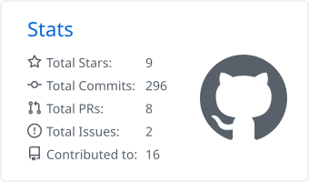
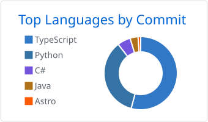

# Hi, I'm TraceOnSnow

I build **AI systems, games, and software for myself**.

Currently interested in AI agents, applied AI engineering, game systems, and building small products that I actually use.

## Selected Projects

### 🎉 [NanoParty](https://github.com/TraceOnSnow/NanoParty)

A self-hosted party game room for friends: guessing, bluffing, voting and card games in the browser, hosted by a shared AI.

`TypeScript` · `React` · `Colyseus` · `PostgreSQL` · `Drizzle` · `LLM` · `Docker`

### 🎮 [SteamGuess](https://github.com/TraceOnSnow/SteamGuess) · [play](https://steamguess.traceonsnow.com)

Guess the Steam game in ten tries from clues such as price, peak players, reviews, release date and tags. Daily challenge, themed presets and multiplayer rooms.

`TypeScript` · `React` · `Node.js` · `SQLite` · `Socket.IO` · `Docker`

### 🗂️ [obsidian-workflow](https://github.com/TraceOnSnow/obsidian-workflow)

A Markdown and Obsidian content library with a CLI, reusable Agent Skills, MCP tools, and guarded publishing sync to my website.

`Python` · `Obsidian` · `MCP` · `Agent Skills` · `Payload CMS`

### 🧵 [chatgpt-pipeline](https://github.com/TraceOnSnow/chatgpt-pipeline)

Turns ChatGPT history into notes: traceable source selection, bounded LLM drafting and review, and idempotent intake into the Markdown library.

`Python` · `LLM` · `Markdown`

### 🃏 [HearthGen](https://github.com/TraceOnSnow/HearthstoneCardGenerator)

Knowledge-graph augmented Hearthstone card generation using structured card semantics, LLM-based design, and Stable Diffusion LoRA.

`Python` · `Knowledge Graph` · `LLM`  · `Stable Diffusion` · `LoRA`

### 🔗 [Atlink](https://github.com/TraceOnSnow/Atlink)

A full-stack URL shortener built around a cached redirect architecture.

`Java` · `Spring Boot` · `React` · `Redis` · `Bigtable`

### 🌐 [Personal Homepage](https://github.com/TraceOnSnow/homepage) · [traceonsnow.com](https://traceonsnow.com)

My personal website: writing, project notes, and a library of the games, books and shows I have been through.

`Astro` · `TypeScript` · `Payload CMS` · `SQLite` · `Tailwind CSS` · `Docker`

## GitHub Activity

 

---

<i>building things around AI, games, and personal software.</i>

